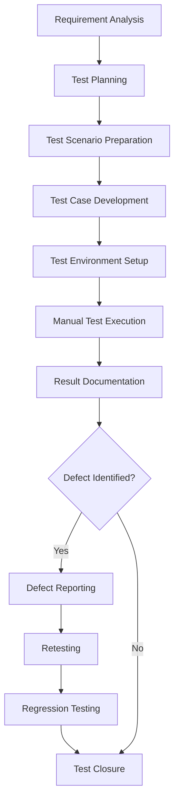
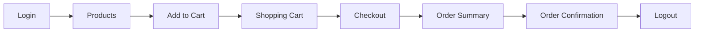
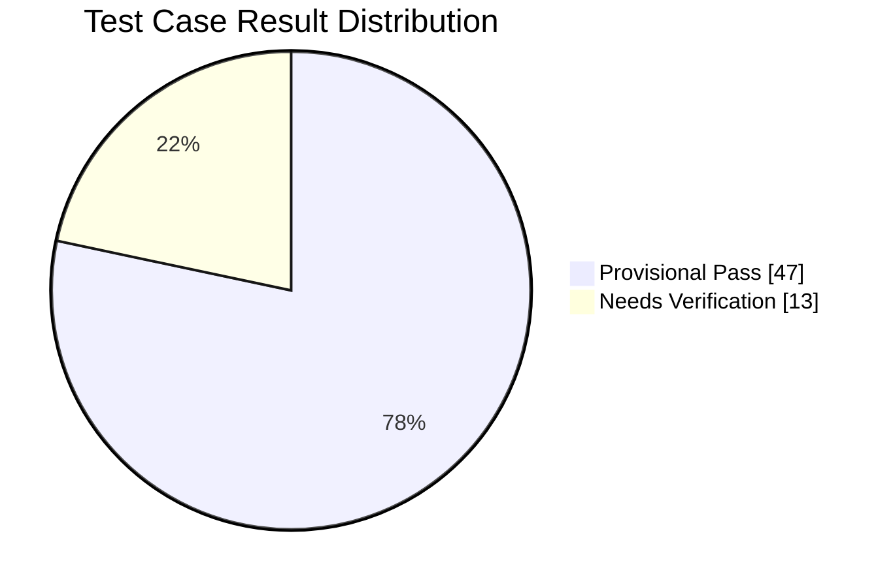
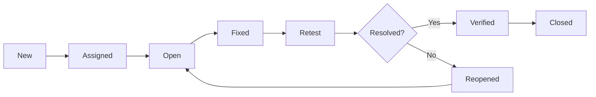

<div align="center">

# 🛒 E-Commerce Website Manual Testing

### Software Quality Assurance | Manual Testing | QA Portfolio


**A practical QA portfolio project demonstrating structured software testing, test documentation, execution reporting, and quality assurance processes.**

[🌐 Application Under Test](https://www.saucedemo.com/)

</div>

---

## 📌 Project Overview

This project focuses on manual testing of SauceDemo, an
e-commerce web application, to evaluate its functionality,
usability, input validation, navigation, and end-to-end
shopping workflows.

The project follows a structured Software Testing Life
Cycle (STLC) approach, covering requirement analysis,
test planning, test scenario preparation, test case design,
manual execution, result documentation, and defect
reporting processes.

---

## 🎯 Project Objectives

- Validate core e-commerce application functionality.
- Verify positive and negative user workflows.
- Identify functional and usability issues.
- Validate login and checkout input fields.
- Verify shopping cart and order calculations.
- Evaluate navigation and session management.
- Maintain traceability between test scenarios and test cases.
- Prepare structured test execution reports.
- Practice professional QA documentation.
- Perform retesting and regression testing where applicable.

---

## 📊 Project Highlights

<div align="center">

| Test Scenarios | Test Cases | Testing Areas |
|:---:|:---:|:---:|
| **53** | **60** | **8** |

| Provisional Pass | Needs Verification |
|:---:|:---:|
| **47** | **13** |

</div>

---

## 🧪 Testing Modules

| Module | Testing Coverage | Test Cases |
|---|---|:---:|
| 🔐 Login | Authentication, invalid credentials, mandatory fields and password masking | 10 |
| 📦 Products & Sorting | Product details, images, prices and sorting | 10 |
| 🛒 Shopping Cart | Add, remove, item count and cart persistence | 10 |
| 📝 Checkout | Form validation, valid and invalid inputs | 10 |
| 💳 Order Summary | Subtotal, tax, total and order confirmation | 8 |
| 🔄 Navigation & Session | Logout, browser navigation and session behavior | 4 |
| 🎨 UI & Compatibility | Readability, accessibility and responsive layout | 5 |
| ⚠️ Negative & Regression | Error handling and regression scenarios | 3 |
| **Total** | | **60** |

---

## 🔍 Testing Types

- Functional Testing
- Positive Testing
- Negative Testing
- Smoke Testing — applicable core workflows
- Sanity Testing — applicable targeted checks
- Input Validation Testing
- UI Testing
- Usability Testing
- Compatibility Testing
- Session Testing
- End-to-End Testing
- Exploratory Testing
- Retesting
- Regression Testing

Testing types represent the project scope and applicable
QA approaches. Individual execution coverage remains
subject to result verification.

---

## 🧠 Testing Techniques

| Technique | Application |
|---|---|
| Equivalence Partitioning | Valid and invalid input categories |
| Boundary Value Analysis | Input length and boundary conditions |
| Decision Table Testing | Login and checkout field combinations |
| State Transition Testing | Login, logout, cart and order states |
| Error Guessing | Unexpected inputs and application behavior |
| Use Case Testing | Complete shopping workflows |
| Exploratory Testing | UI, navigation and usability checks |

---

## 🔄 Software Testing Life Cycle



Final test closure is pending verification of the
reconstructed execution results.

---

## 🛍️ Application Workflow



---

## 📈 Test Execution Dashboard

### Overall Test Case Summary

| Execution Status | Count | Percentage |
|---|:---:|:---:|
| 🟢 Provisional Pass | 47 | 78.33% |
| 🟡 Needs Verification | 13 | 21.67% |
| 🔴 Confirmed Failed | Not Established | — |
| ⚪ Confirmed Blocked | Not Established | — |
| **Total Test Cases** | **60** | **100%** |

### Provisional Result Distribution



### Module-wise Execution Summary

| Module | Total | Provisional Pass | Needs Verification |
|---|:---:|:---:|:---:|
| Login | 10 | 10 | 0 |
| Products & Sorting | 10 | 9 | 1 |
| Shopping Cart | 10 | 10 | 0 |
| Checkout | 10 | 7 | 3 |
| Order Summary | 8 | 7 | 1 |
| Navigation & Session | 4 | 2 | 2 |
| UI & Compatibility | 5 | 1 | 4 |
| Negative & Regression | 3 | 1 | 2 |
| **Total** | **60** | **47** | **13** |

### Test Scenario Summary

| Metric | Count |
|---|:---:|
| Total Test Scenarios | 53 |
| Provisional Passed Scenarios | 41 |
| Scenarios Requiring Verification | 12 |
| Provisional Pass Percentage | 77.36% |

> **Result Transparency:** Manual testing was performed,
> but the original execution records were not retained.
> The displayed results are reconstructed classifications
> and must be verified before being treated as confirmed
> test execution evidence.

---

## 📋 Test Case Documentation

Each test case includes:

- Test Case ID
- Test Scenario
- Preconditions
- Test Data
- Test Steps
- Expected Result
- Actual Result
- Execution Status

### Sample Test Case

| Field | Description |
|---|---|
| Test Case ID | TC001 |
| Test Scenario | Verify login with valid credentials |
| Module | Login |
| Preconditions | Application login page is accessible |
| Test Data | standard_user / secret_sauce |
| Test Steps | Enter valid credentials and click Login |
| Expected Result | User should navigate to the products page |
| Reconstructed Result | User navigates to the products page |
| Status | Provisional Pass |

---

## 🔗 Requirement Traceability

Test scenarios are mapped to their corresponding test cases
to maintain functional coverage and traceability.

| Scenario ID | Scenario | Test Case ID |
|---|---|---|
| TS001 | Valid login | TC001 |
| TS002 | Invalid username | TC002 |
| TS009 | Product listing | TC011 |
| TS012 | Name sorting A to Z | TC016 |
| TS017 | Add product to cart | TC021 |
| TS022 | Remove product from cart | TC025 |
| TS027 | Valid checkout | TC032 |
| TS035 | Subtotal calculation | TC043 |
| TS037 | Order completion | TC046 |
| TS040 | Logout functionality | TC049 |

---

## 🐞 Defect Management

The project follows a structured defect reporting process.

### Defect Report Fields

- Defect ID
- Related Test Case ID
- Defect Title
- Module
- Environment
- Preconditions
- Steps to Reproduce
- Expected Result
- Actual Result
- Severity
- Priority
- Screenshot or Evidence
- Defect Status

### Defect Life Cycle



### Severity Classification

| Severity | Description |
|---|---|
| Critical | Application or major workflow becomes unusable |
| High | Important functionality is affected |
| Medium | Partial functionality is affected |
| Low | Minor UI or cosmetic issue |

### Priority Classification

| Priority | Description |
|---|---|
| P1 - High | Requires immediate attention |
| P2 - Medium | Requires resolution within a planned cycle |
| P3 - Low | Can be resolved in a future update |

**Current Defect Status:** Confirmed defect count has not
been established. Potential issues require reproduction
and supporting evidence.

---

## 📁 Project Deliverables

| Document | Description | Status |
|---|---|---|
| Test Plan | Testing scope, strategy, criteria and risks | Completed |
| Test Scenarios | 53 functional and non-functional scenarios | Completed |
| Test Cases | 60 detailed manual test cases | Completed |
| Test Data | Valid, invalid and fictional input data | Documented |
| Test Execution Report | Module-wise execution results | Provisional |
| Bug Reports | Defect reporting documentation | Pending confirmation |
| Excel Dashboard | Execution metrics and visual reporting | Sample data requires reconciliation |
| Test Evidence | Screenshots and execution records | Original records unavailable |

---

## 📂 Repository Structure

The repository is organized around the following
QA documentation categories:

```text
Ecommerce-Website-Manual-Testing/
│
├── Test Plan
├── Test Scenarios
├── Test Cases
├── Test Data
├── Test Execution Report
├── Bug Reports
├── Excel Test Execution Dashboard
└── README.md
```

---

## 💻 Test Environment

| Parameter | Details |
|---|---|
| Application | SauceDemo |
| Application Type | Web Application |
| Testing Method | Manual Testing |
| Operating System | Original details not retained |
| Browser | Original details not retained |
| Browser Version | Not recorded |
| Test Data | Demo credentials and fictional inputs |
| Documentation | Markdown and Microsoft Excel |
| Version Control | Git and GitHub |

---

## 🛠️ Tools and Technologies

<div align="center">


</div>

---

## 🚀 How to Explore This Project

1. Open the SauceDemo application.
2. Review the Test Plan document.
3. Review the 53 documented test scenarios.
4. Explore the 60 detailed test cases.
5. Execute test cases using the provided demo test data.
6. Compare observed results with expected results.
7. Update the execution status and capture evidence.
8. Document reproducible defects.
9. Review the execution report and dashboard.

### Demo Credentials

| Field | Value |
|---|---|
| Username | standard_user |
| Password | secret_sauce |

These credentials are publicly provided by the
SauceDemo practice application.

---

## 🎓 Skills Demonstrated

- Software Testing Life Cycle (STLC)
- Requirement Analysis
- Test Planning and Strategy
- Test Scenario Preparation
- Test Case Design
- Manual Test Execution
- Functional and Negative Testing
- Test Data Preparation
- Requirement Traceability
- Defect Reporting Processes
- Severity and Priority Classification
- Test Execution Reporting
- QA Documentation
- Microsoft Excel
- Git and GitHub

---

## 📌 Current Project Status

- [x] Requirement Analysis
- [x] Test Planning
- [x] Test Scenario Preparation
- [x] Test Case Development
- [x] Test Data Preparation
- [x] Manual Execution — User Reported
- [x] Reconstructed Result Documentation
- [ ] Final Result Verification
- [ ] Defect Confirmation
- [ ] Retesting and Regression, where applicable
- [ ] Final Test Closure

---

## 🔮 Future Enhancements

- Verify all reconstructed test results.
- Capture screenshots for execution evidence.
- Expand cross-browser testing.
- Add detailed accessibility testing.
- Improve requirement traceability coverage.
- Update the Excel execution dashboard.
- Automate selected workflows using Selenium.
- Implement Playwright automation tests.
- Integrate automated test execution with GitHub Actions.

---

## 📝 Conclusion

This project demonstrates a structured approach to
manual software testing of an e-commerce application.

It includes 53 test scenarios and 60 detailed test cases
covering major application workflows, along with test
planning, traceability, execution reporting, and defect
management documentation.

The project serves as a practical QA portfolio showcasing
manual testing knowledge, analytical thinking, attention
to detail, and professional software testing practices.

---

## 👩‍💻 Author

<div align="center">

### Gade Ameesha

**Software Developer | QA Engineer**

[](https://github.com/GadeAmeesha)
[](https://www.linkedin.com/in/gade-ameesha/)

---

⭐ **If you find this project useful, consider starring the repository.**

*Quality is not just about finding defects — it is about building confidence in software.*

</div>
